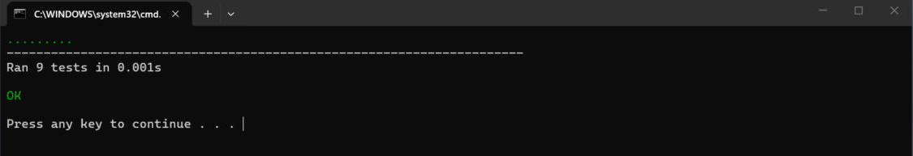
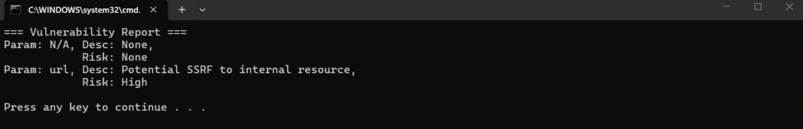
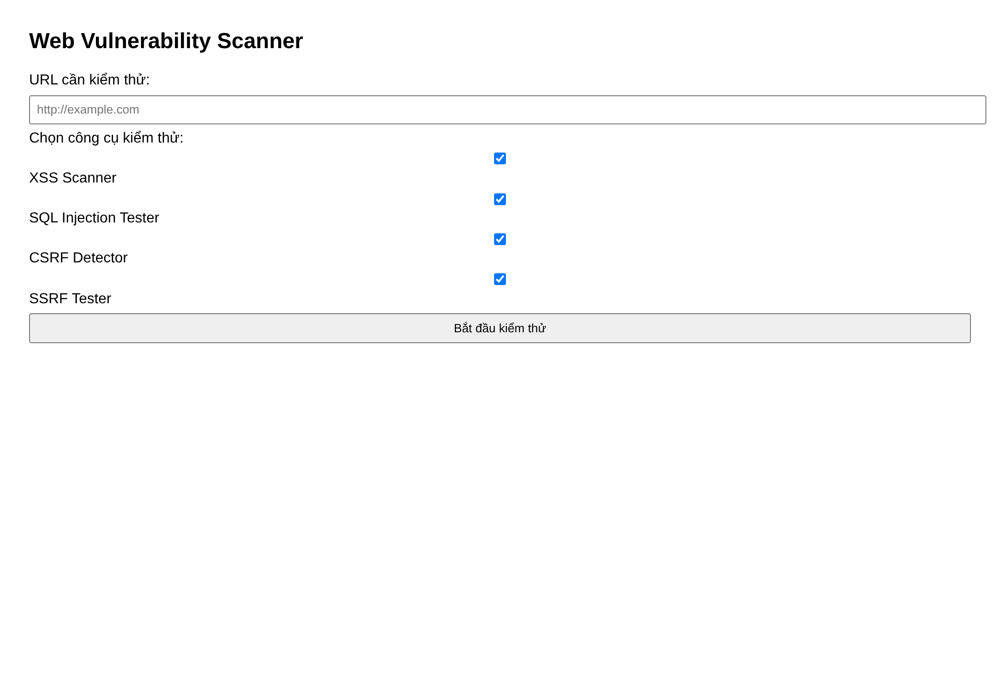
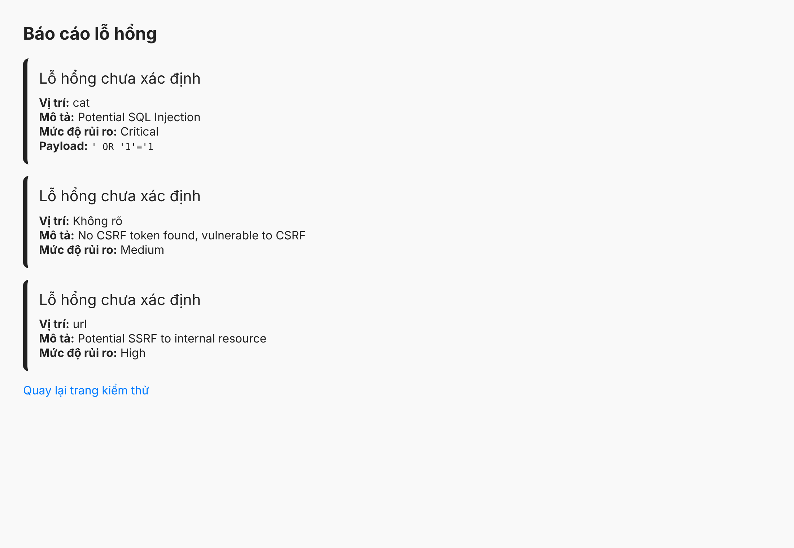
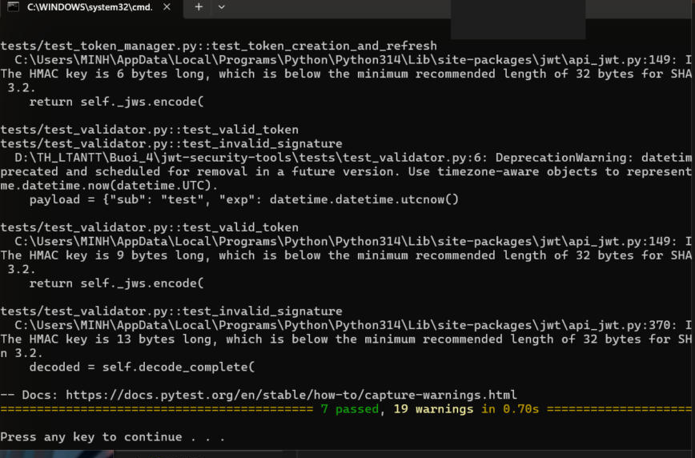
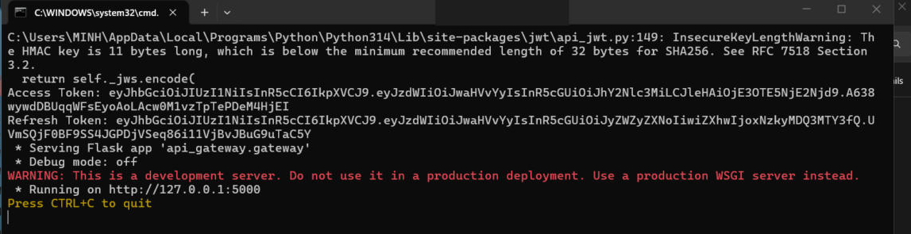
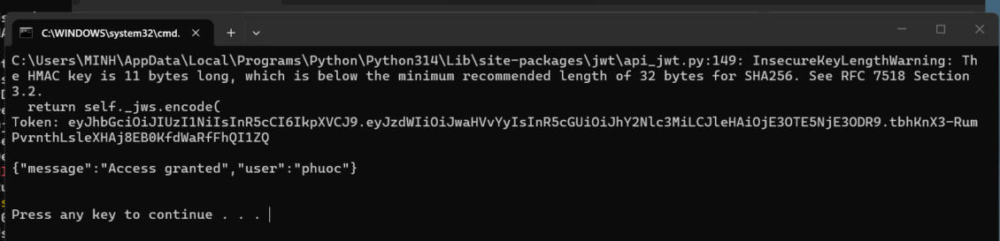

# BÀI 4 – BẢO MẬT WEB APP VÀ API

Bài thực hành gồm hai phần:

1. **WebVulnScanner** (`web-vuln-scanner`): công cụ quét các lỗ hổng ứng dụng web phổ biến (XSS, SQLi, CSRF, SSRF) và sinh báo cáo, có giao diện web.
2. **JWTSecure** (`jwt-security-tools`): bộ công cụ làm việc an toàn với JWT và OAuth 2.0 (kiểm tra token, brute-force khoá yếu, quản lý vòng đời token, API Gateway xác thực bằng JWT).

**Môi trường chạy:** Windows, Python 3.14, Flask, PyJWT, pytest.

---

## PHẦN 1 – WebVulnScanner

Công cụ quét 4 nhóm lỗ hổng web, mỗi lỗ hổng là một module riêng. Kết quả quét được gom lại qua `ReportGenerator` và hiển thị ở console hoặc trên giao diện web Flask.

### Cấu trúc

```
web-vuln-scanner/
├── main.py                     # chạy thử toàn bộ scanner ở console
├── requirements.txt
├── scanners/
│   ├── xss_scanner.py          # XSSScanner
│   ├── sql_injection_tester.py # SQLInjectionTester
│   ├── csrf_detector.py        # CSRFDetector
│   └── ssrf_tester.py          # SSRFTester
├── report/
│   └── report_generator.py     # ReportGenerator
├── tests/                      # 9 unit test
└── ui/
    ├── app.py                  # web UI bằng Flask
    └── templates/              # index.html, result.html
```

### Các module

- **XSSScanner** – gửi các payload XSS (`<script>alert(1)</script>`, `'><svg/onload=alert(1)>`) vào URL rồi kiểm tra payload có bị phản hồi lại trong nội dung trang không.
- **SQLInjectionTester** – tách tham số trên URL và so khớp với tập payload SQLi (`' OR '1'='1`, `'; DROP TABLE users;--`, …) để phát hiện khả năng injection.
- **CSRFDetector** – kiểm tra form HTML có chứa CSRF token (`csrf_token`, `_csrf`, `csrfmiddlewaretoken`) hay không; không có token thì cảnh báo nguy cơ CSRF.
- **SSRFTester** – dò trong tham số URL các địa chỉ nội bộ (`127.0.0.1`, `localhost`, `10.x`, `192.168.x`, `172.16–31.x`) để phát hiện nguy cơ SSRF.
- **ReportGenerator** – gom kết quả từ các scanner thành một báo cáo thống nhất.

### Cách chạy

```bat
cd web-vuln-scanner
pip install -r requirements.txt
python -m unittest discover tests   :: chạy 9 unit test
python main.py                      :: chạy thử ở console
python ui\app.py                    :: chạy giao diện web (http://127.0.0.1:5000)
```

### Kết quả

**Unit test – 9/9 PASS:**



**Chạy chương trình chính (`main.py`):** phát hiện lỗ hổng SSRF tới `127.0.0.1` trong URL mẫu.



**Giao diện web – trang nhập URL và chọn công cụ kiểm thử:**



**Kết quả quét hiển thị trên web** (URL mẫu có SQLi và SSRF): công cụ liệt kê SQL Injection (Critical), CSRF (Medium) và SSRF (High).



---

## PHẦN 2 – JWTSecure

Bộ công cụ bảo mật JWT, mỗi chức năng là một package riêng, có bộ test bằng pytest.

### Cấu trúc

```
jwt-security-tools/
├── main.py                     # sinh token + chạy API Gateway
├── requirements.txt
├── pytest.ini
├── jwt_validator/   validator.py   # JWTValidator
├── jwt_cracker/     cracker.py     # JWTCracker
├── oauth_client/    client.py      # OAuthClient
├── token_manager/   manager.py     # TokenManager
├── api_gateway/     gateway.py     # APIGateway
└── tests/                          # 7 test
```

### Các module

- **JWTValidator** – giải mã và kiểm tra tính hợp lệ của token, phân biệt các lỗi: hết hạn, sai chữ ký, token không hợp lệ.
- **JWTCracker** – thử brute-force khoá bí mật ký JWT dựa trên wordlist (minh hoạ rủi ro khi dùng secret yếu), chạy đa luồng.
- **TokenManager** – quản lý vòng đời token: phát hành access token (ngắn hạn) + refresh token (dài hạn), và cấp lại access token từ refresh token.
- **OAuthClient** – dựng URL xác thực OAuth 2.0 (Authorization Code Flow) và đổi `code` lấy access token.
- **APIGateway** – cổng API Flask với endpoint `/protected`, chỉ cho truy cập khi kèm JWT hợp lệ trong header `Authorization: Bearer`.

### Cách chạy

```bat
cd jwt-security-tools
pip install -r requirements.txt
pytest tests/        :: chạy 7 test
python main.py       :: in token và khởi động API Gateway tại http://127.0.0.1:5000
```

Sau khi `main.py` chạy, kiểm tra xác thực của Gateway bằng lệnh:

```bat
curl -H "Authorization: Bearer <access_token>" http://127.0.0.1:5000/protected
```

### Kết quả

**Kiểm thử – 7/7 PASS** (các warning là `InsecureKeyLengthWarning`/`DeprecationWarning` của thư viện, không ảnh hưởng kết quả):



**Chạy `main.py`:** in Access Token, Refresh Token và khởi động API Gateway.



**Kiểm tra xác thực Gateway bằng `curl`:** gửi token hợp lệ, Gateway trả về `Access granted`.



---

## Ghi chú

- Token và secret (`supersecret`) trong bài chỉ là giá trị mẫu để minh hoạ, không dùng cho môi trường thật.
- Toàn bộ test của hai phần đều PASS (9/9 và 7/7); các ảnh trên là ảnh chụp màn hình thực tế khi chạy trên máy.
