# BÁO CÁO BÀI 5 – PHÂN TÍCH VÀ KIỂM THỬ BẢO MẬT (SAST & DAST)

> Họ và tên: …………………………  ·  MSSV: ……………  ·  Lớp: …………  ·  Môn: Lập trình an ninh thông tin

Bài thực hành xây dựng hai công cụ kiểm thử bảo mật cho mã nguồn Python, đại diện cho hai cách tiếp cận bổ sung nhau:

- **SAST (Static Analysis Security Testing)** – phân tích **tĩnh** mã nguồn mà không chạy chương trình, dựa trên cây cú pháp trừu tượng (AST), so khớp mẫu (pattern matching) và các chỉ số chất lượng mã để phát hiện lỗ hổng sớm, rồi xuất báo cáo chuẩn **SARIF**.
- **DAST (Dynamic Analysis Security Testing)** – phân tích **động** hành vi ứng dụng khi đang chạy: giám sát tài nguyên, bộ nhớ, mạng, dò hành vi nguy hiểm và cách ly thực thi trong sandbox; đồng thời cung cấp **REST API** bằng Flask.

SAST tìm lỗ hổng nằm trong mã; DAST tìm lỗ hổng chỉ bộc lộ lúc chạy.

```
Buoi_5/
├── sast-tool/        # Công cụ phân tích tĩnh
├── dast-tool/        # Công cụ phân tích động
├── images/           # Ảnh chụp màn hình các bước chạy
└── README.md         # Báo cáo này
```

> **Môi trường chạy minh hoạ:** Ubuntu 24.04, Python 3.13 (lệnh dùng `python3`; trên Windows thay bằng `python`). Mọi ảnh trong báo cáo là ảnh chụp **kết quả chạy thật** của chính bộ mã này (terminal và trình duyệt), không dùng ảnh dựng giả.

---

# Phần A – SAST-TOOL

## A.1. Cấu trúc

```
sast-tool/
├── examples/
│   ├── vulnerable_01.py      # File mẫu: eval, hardcoded password, pickle
│   └── vulnerable_02.py      # File mẫu: eval, exec
├── rules/
│   └── default_rules.json    # Bộ luật: ánh xạ loại lỗi -> mức độ (severity)
├── sast_tool/
│   ├── __init__.py
│   ├── ast_analyzer.py           # Duyệt AST, phát hiện gọi eval()
│   ├── vuln_pattern_matcher.py   # Regex nhận diện mẫu nguy hiểm
│   ├── security_rule_engine.py   # Gán severity theo rule
│   ├── code_quality_checker.py   # Gọi flake8 lấy lỗi chất lượng mã
│   ├── sarif_reporter.py         # Xuất report.sarif (chuẩn SARIF 2.1.0)
│   └── main.py                   # Điều phối toàn bộ pipeline
├── tests/                    # 6 unit test
└── requirements.txt          # flake8, sarif-om, jsonpickle
```

## A.2. Kiến trúc và cách triển khai

Công cụ được tách thành năm thành phần, mỗi thành phần một nhiệm vụ rõ ràng và ghép lại trong `main.py`. Tách thành phần giúp dễ kiểm thử từng phần, dễ bổ sung luật/mẫu mới và tách biệt khâu *phát hiện* với khâu *đánh giá mức độ* và *xuất báo cáo*.

- **ASTAnalyzer** – dùng thư viện `ast`, duyệt toàn bộ cây cú pháp (`ast.walk`) và đánh dấu mọi lời gọi hàm `eval`. Phân tích trên AST thay vì tìm chuỗi giúp nhận diện đúng ngữ cảnh “lời gọi hàm”, tránh báo nhầm khi chuỗi `eval` chỉ nằm trong tên biến hay comment.
- **VulnPatternMatcher** – dùng biểu thức chính quy nhận diện hai mẫu nguy hiểm phổ biến: mật khẩu gán cứng (`password = "..."`) và `import pickle`.
- **CodeQualityChecker** – gọi `flake8` qua `subprocess` để bắt các lỗi chất lượng mã (import thừa, sai quy ước khoảng trắng…). Mã kém chất lượng thường đi kèm rủi ro bảo mật và khó bảo trì.
- **SecurityRuleEngine** – đọc `rules/default_rules.json` để gán mức độ nghiêm trọng (high/medium/low) cho từng loại lỗi, cho phép mở rộng luật mà không phải sửa mã.
- **SarifReporter** – dùng `sarif-om` và `jsonpickle` xuất báo cáo theo chuẩn **SARIF 2.1.0** – định dạng chuẩn công nghiệp, mở được bằng SARIF Viewer của VS Code và tích hợp được vào CI/CD.

**Luồng xử lý:** đọc file cần phân tích → `ASTAnalyzer` + `VulnPatternMatcher` + `CodeQualityChecker` cùng quét → `SecurityRuleEngine` gán mức độ nghiêm trọng → `SarifReporter` ghi `report.sarif`.

## A.3. Cài đặt thư viện

```bash
cd sast-tool
pip install -r requirements.txt
```

Kiểm tra 3 thư viện đã sẵn sàng (`flake8` dùng cho kiểm tra chất lượng mã; `sarif-om` + `jsonpickle` dùng để xuất SARIF):

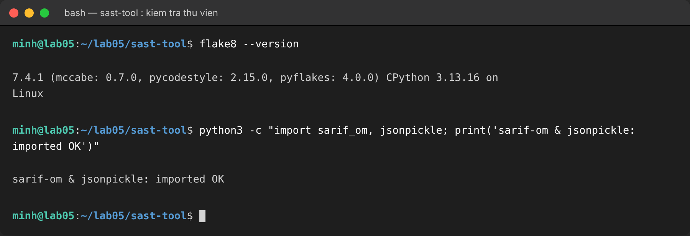

## A.4. Chạy Unit Test

```bash
python3 -m unittest discover tests
```

Toàn bộ **6 test PASS** (mỗi thành phần một test):

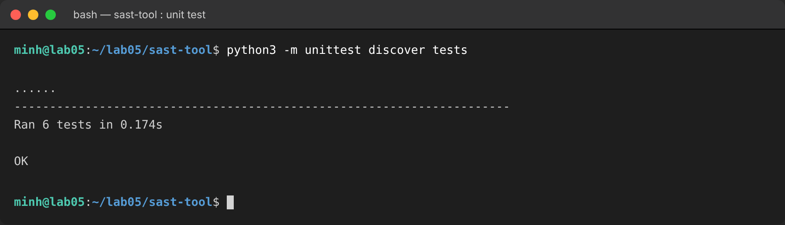

## A.5. Phân tích file không an toàn `vulnerable_01.py`

```bash
python3 -m sast_tool.main examples/vulnerable_01.py
```

Công cụ phát hiện **8 vấn đề** và ghi vào `report.sarif`:

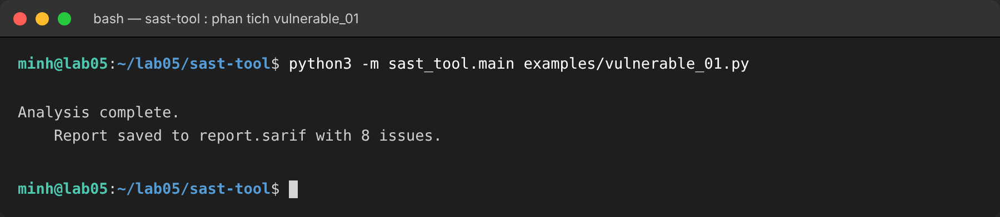

## A.6. Mở `report.sarif`

File xuất đúng chuẩn **SARIF 2.1.0**, tool `PySAST` phiên bản `1.0.0`. Có thể mở bằng tiện ích **SARIF Viewer** trong VS Code hoặc xem trực tiếp nội dung JSON:

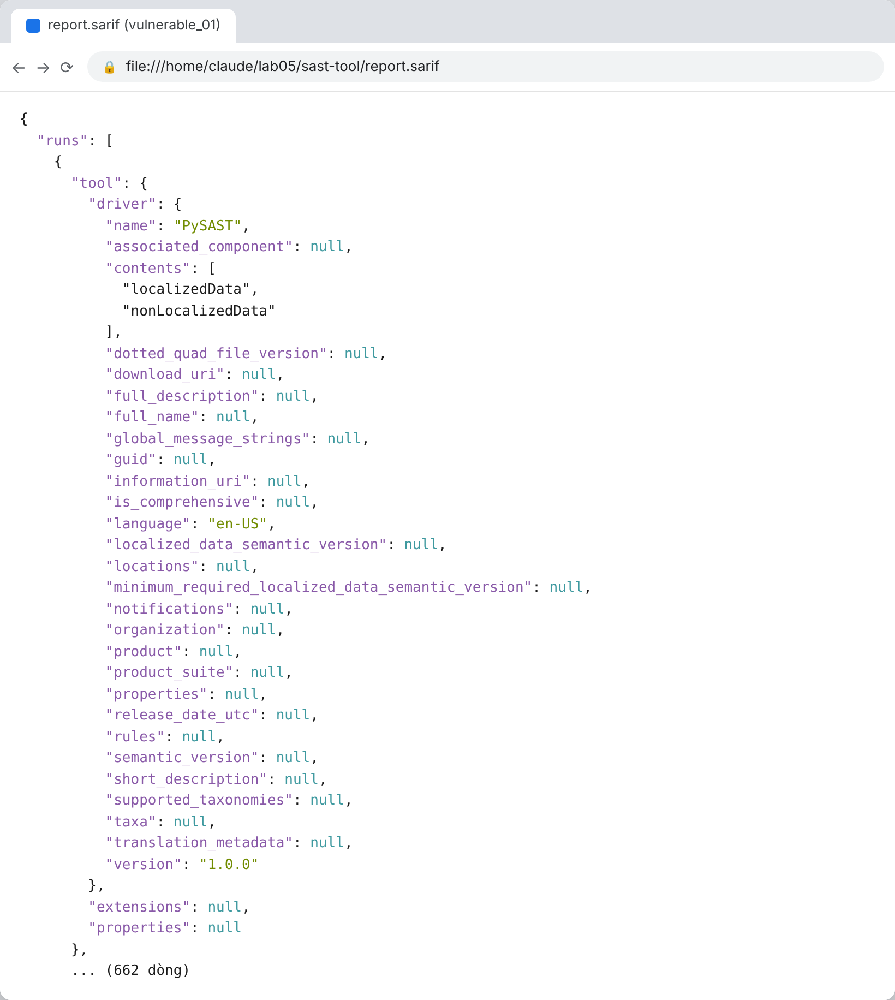

## A.7. Phân tích file không an toàn khác `vulnerable_02.py`

```bash
python3 -m sast_tool.main examples/vulnerable_02.py
```

Lần này công cụ phát hiện **4 vấn đề** (1 lỗi `eval`, 3 lỗi chất lượng mã):


## A.8. Phân tích lỗ hổng và nguyên nhân gốc

Chi tiết toàn bộ 8 + 4 vấn đề công cụ phát hiện:

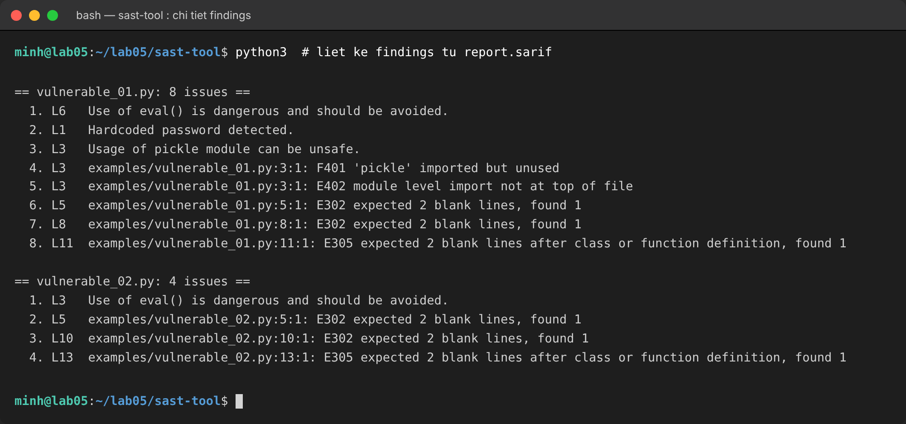

Nguyên nhân gốc về mặt kỹ thuật của từng loại lỗ hổng:

- **Thực thi mã qua `eval()`** (vulnerable_01 dòng 6, vulnerable_02 dòng 3): `eval` biên dịch và thực thi bất kỳ biểu thức Python nào, nên nếu chuỗi truyền vào do người dùng kiểm soát thì kẻ tấn công có thể chèn và chạy mã tùy ý (Remote Code Execution), ví dụ truyền `__import__('os').system(...)`.
- **Mật khẩu gán cứng** (vulnerable_01 dòng 1): bí mật nằm thẳng trong mã nguồn nên bất kỳ ai đọc được mã – kể cả qua lịch sử git – đều lấy được; khó thay đổi và khó thu hồi khi lộ.
- **`import pickle` và `exec()`** (vulnerable_01 dòng 3, vulnerable_02 dòng 11): `pickle` thực thi hàm khởi tạo đối tượng trong lúc giải tuần tự nên với dữ liệu không tin cậy, kẻ tấn công chế tạo payload qua `__reduce__` để chạy mã (insecure deserialization); `exec` cho phép thực thi câu lệnh tùy ý tương tự `eval`.
- **Lỗi chất lượng mã từ flake8** (import thừa `F401`, import không ở đầu file `E402`, thiếu dòng trống chuẩn `E302`/`E305`): không phải lỗ hổng trực tiếp nhưng làm tăng bề mặt tấn công (import thừa) và giảm khả năng bảo trì, audit.

## A.9. Biện pháp phòng chống

- Thay `eval`/`exec` bằng phân tích an toàn: dùng `ast.literal_eval` cho dữ liệu literal hoặc viết parser riêng; tuyệt đối không `eval` đầu vào người dùng.
- Không gán cứng bí mật: dùng biến môi trường hoặc trình quản lý bí mật (Vault, KMS) và thêm quét secret vào pipeline (git-secrets, trufflehog, GitSecure) để chặn commit lộ khóa.
- Tránh `pickle` cho dữ liệu không tin cậy: ưu tiên JSON; nếu buộc dùng thì ký và xác thực dữ liệu trước khi giải tuần tự.
- Sửa triệt để lỗi lint và tích hợp SAST vào CI/CD để chặn mã lỗi trước khi merge.

---

# Phần B – DAST-TOOL

## B.1. Cấu trúc

```
dast-tool/
├── __init__.py
├── runtime_monitor.py            # CPU, RAM, file đang mở của tiến trình
├── memory_analyzer.py            # Phát hiện rò rỉ bộ nhớ & tràn số
├── network_traffic_analyzer.py   # Thống kê lưu lượng mạng theo card
├── security_behavior_checker.py  # Dò lời gọi nguy hiểm (os.system, eval, exec)
├── virtual_sandbox.py            # Chạy lệnh cách ly trong thư mục tạm
├── main.py                       # Chạy giám sát trực tiếp
├── app.py                        # REST API bằng Flask
├── tests/                        # 5 unit test
└── requirements.txt              # psutil, Flask
```

## B.2. Kiến trúc và cách triển khai

Nền tảng phân tích động gồm năm thành phần. Ngoài `main.py` chạy giám sát trực tiếp, `app.py` cung cấp REST API bằng Flask để truy vấn từng chức năng qua HTTP, thuận tiện tích hợp dashboard hoặc giám sát từ xa.

- **RuntimeMonitor** – dùng `psutil` đọc CPU, bộ nhớ (RSS) và danh sách file đang mở của tiến trình.
- **MemoryAnalyzer** – dùng `gc` tìm đối tượng rò rỉ (có `__del__` nằm trong `gc.garbage`) và kiểm tra tràn số theo ngưỡng `2**63`.
- **NetworkTrafficAnalyzer** – thống kê lưu lượng theo từng card mạng qua `psutil.net_io_counters`.
- **SecurityBehaviorChecker** – dò các lời gọi nguy hiểm (`os.system`, `eval`, `exec`) trong mã đang chạy.
- **VirtualSandbox** – tạo thư mục tạm và chạy lệnh cách ly trong đó qua `subprocess`.

## B.3. Cài đặt thư viện

```bash
cd dast-tool
pip install -r requirements.txt
```

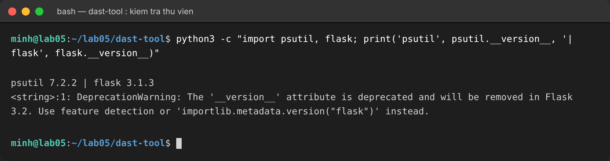

## B.4. Chạy Unit Test

```bash
python3 -m unittest discover -s tests
```

Toàn bộ **5 test PASS**:

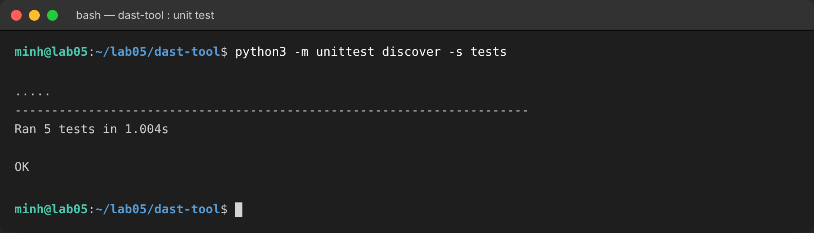

## B.5. Chạy giám sát trực tiếp `main.py`

```bash
python3 main.py
```

Chương trình tự giám sát chính tiến trình của nó: CPU, bộ nhớ, file đang mở, kiểm tra rò rỉ/tràn, thống kê mạng, phát hiện các lời gọi `['os.system', 'eval', 'exec']` và chạy thử sandbox:

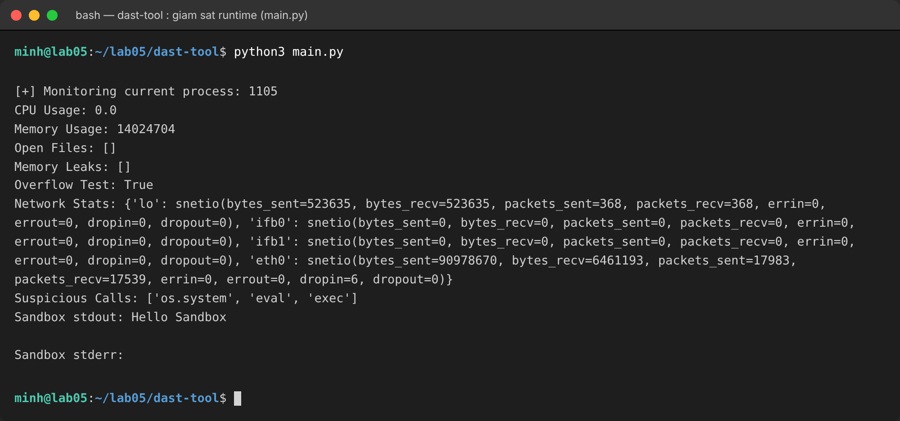

## B.6. Giám sát qua REST API (Flask)

```bash
python3 app.py
```

Server chạy tại `http://127.0.0.1:5000`:

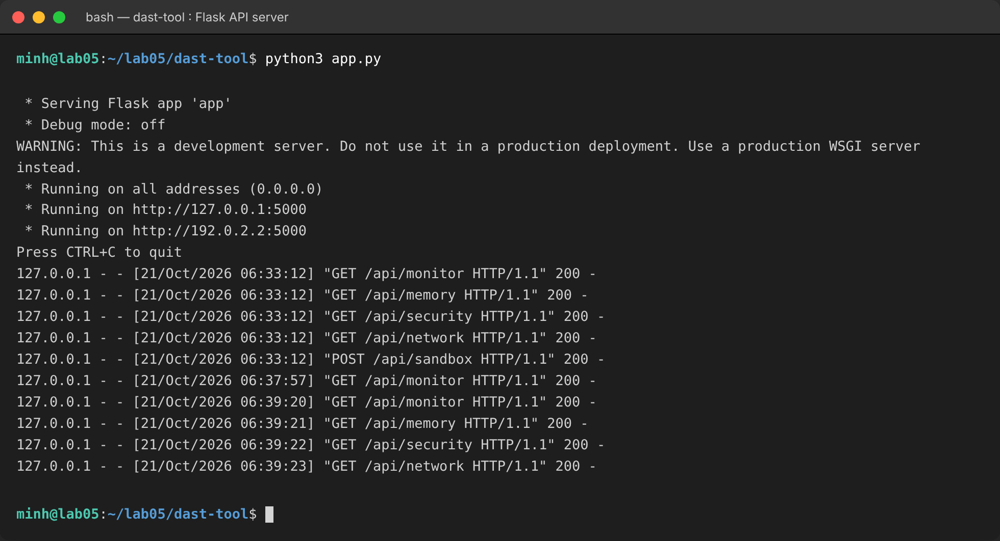

### Các endpoint

| Method | Endpoint | Chức năng |
|--------|----------|-----------|
| GET  | `/api/monitor`  | CPU, bộ nhớ, file đang mở |
| GET  | `/api/memory`   | Rò rỉ bộ nhớ, kiểm tra tràn |
| GET  | `/api/network`  | Thống kê lưu lượng mạng |
| GET  | `/api/security` | Danh sách lời gọi nguy hiểm |
| POST | `/api/sandbox`  | Chạy lệnh trong sandbox |

**`GET /api/monitor`**

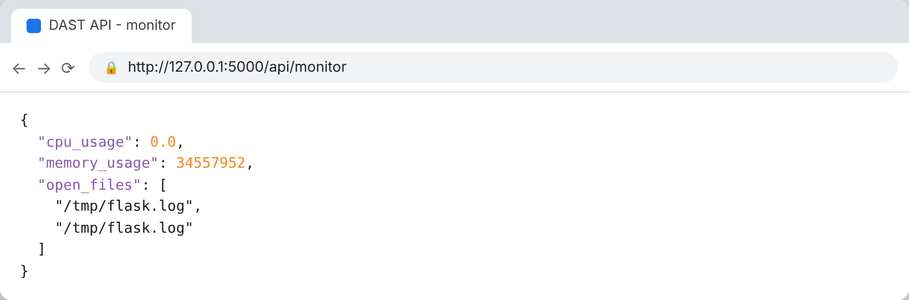

**`GET /api/memory`**

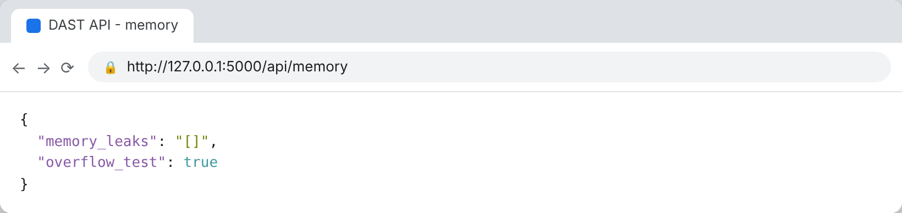

**`GET /api/security`**

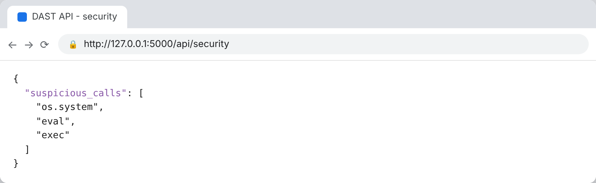

**`GET /api/network`**

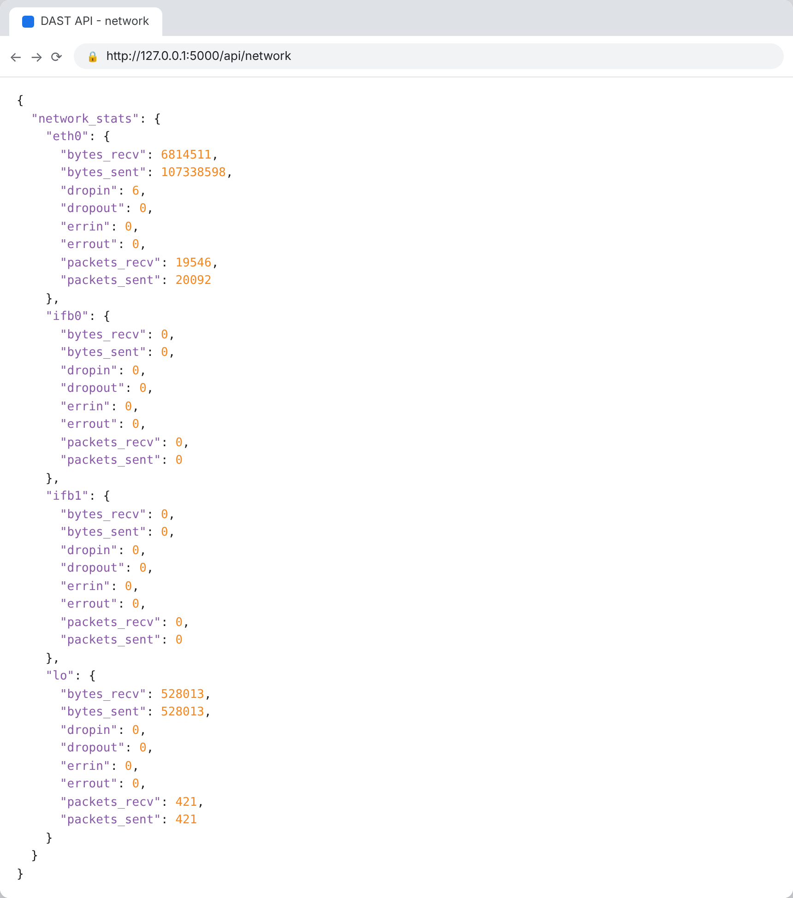

**`POST /api/sandbox`** – gửi lệnh để chạy cách ly:

```bash
curl -s -X POST http://127.0.0.1:5000/api/sandbox \
  -H "Content-Type: application/json" \
  -d '{"command":"echo Hello from Sandbox API"}'
```

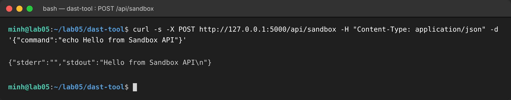

## B.7. Phân tích rủi ro

Một số điểm cần lưu ý về bảo mật của chính nền tảng phân tích động:

- `VirtualSandbox` dùng `subprocess.run(..., shell=True)`: nếu `command` do bên ngoài kiểm soát thì bị command injection. “Sandbox” ở đây chỉ cách ly thư mục làm việc, không cách ly tiến trình hay hệ thống thật.
- Endpoint `POST /api/sandbox` nhận `command` từ request và chạy trực tiếp, về bản chất là thực thi mã từ xa theo thiết kế (phục vụ học tập); nếu để lộ ra mạng mà không bảo vệ thì cực kỳ nguy hiểm.
- `SecurityBehaviorChecker` nhận diện dựa trên đọc mã nguồn nên chỉ bắt được mẫu đã biết (rule-based), không phát hiện được hành vi lạ chưa từng biết.
- Kiểm tra tràn số chỉ mang tính minh họa vì số nguyên Python có độ chính xác tùy ý, không “tràn” theo nghĩa của ngôn ngữ C.

## B.8. Biện pháp phòng chống

- Bỏ `shell=True`, truyền tham số dạng danh sách; chạy trong môi trường cách ly thật (container/VM, seccomp, hạ quyền) thay vì chỉ đổi thư mục.
- Bảo vệ endpoint nhạy cảm (`/api/sandbox`) bằng xác thực/ủy quyền, giới hạn lệnh theo danh sách trắng hoặc loại khỏi bản chạy thật; không bind `0.0.0.0` khi không cần.
- Kết hợp rule-based với phân tích bất thường (anomaly/heuristic) để tăng khả năng phát hiện.
- Dùng WSGI production (gunicorn/uwsgi) thay cho server debug của Flask khi triển khai.

---


