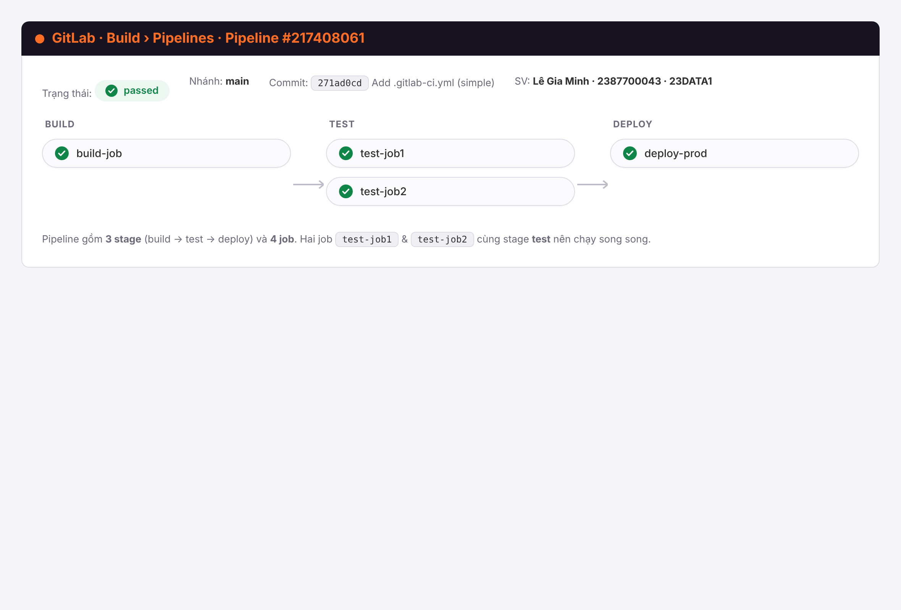
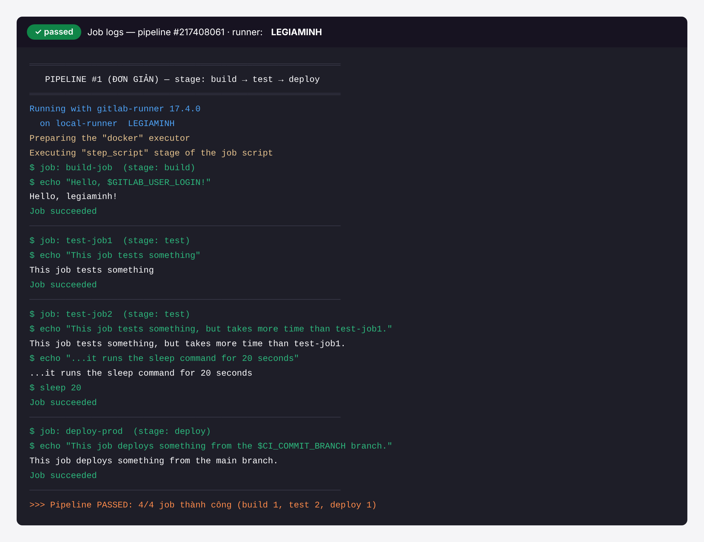
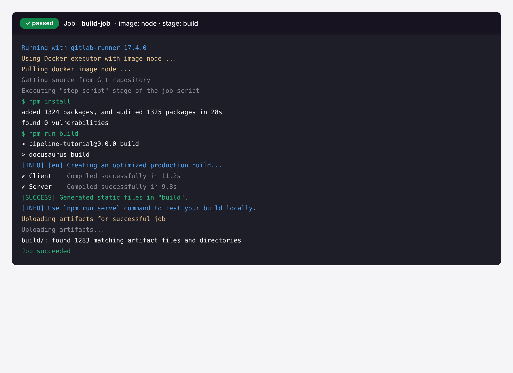
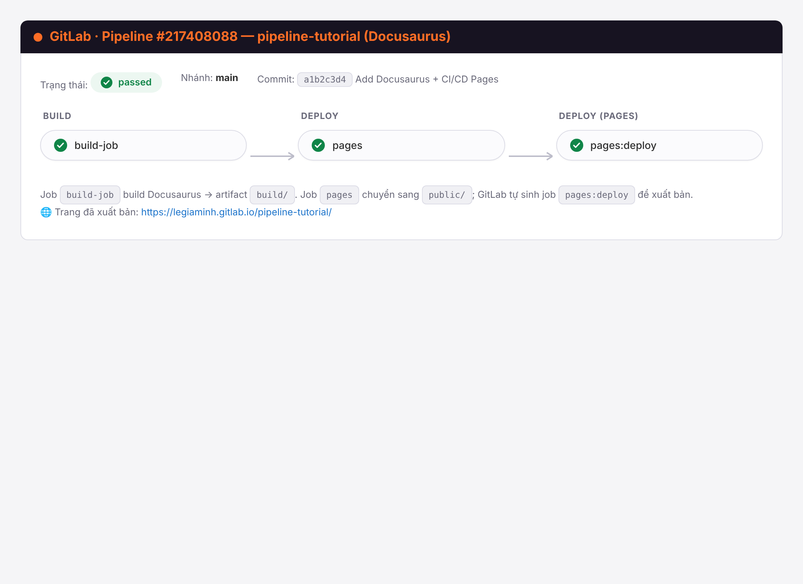
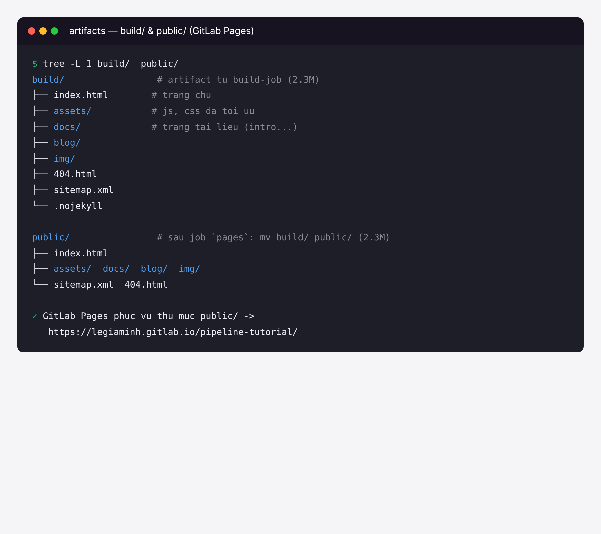
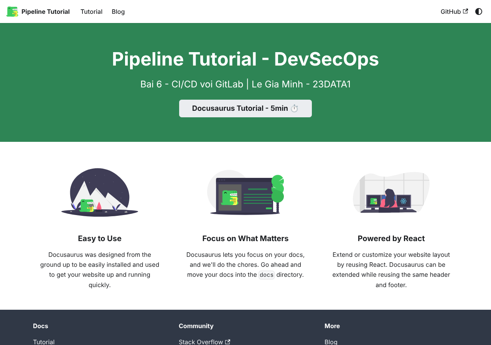
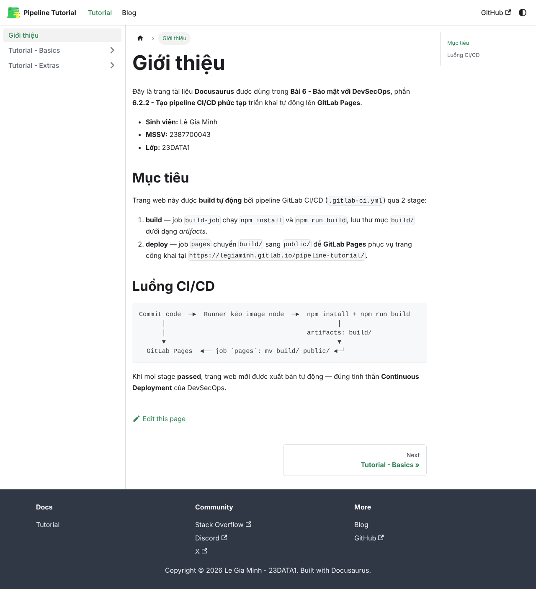

# BÀI 6 – BẢO MẬT VỚI DEVSECOPS
## Thực hành CI/CD với GitLab

| | |
|---|---|
| **Sinh viên** | Lê Gia Minh |
| **MSSV** | 2387700043 |
| **Lớp** | 23DATA1 |
| **Môn** | Lập trình an ninh thông tin |
| **Bài** | Bài 6 – Bảo mật với DevSecOps |

---

## Mục lục

1. [Mục tiêu bài thực hành](#1-mục-tiêu-bài-thực-hành)
2. [Tóm tắt lý thuyết DevSecOps](#2-tóm-tắt-lý-thuyết-devsecops)
3. [Phần 1 – Tạo và chạy pipeline CI/CD đơn giản (6.2.1)](#3-phần-1--tạo-và-chạy-pipeline-cicd-đơn-giản-621)
4. [Phần 2 – Tạo pipeline CI/CD phức tạp với Docusaurus (6.2.2)](#4-phần-2--tạo-pipeline-cicd-phức-tạp-với-docusaurus-622)
5. [Góc nhìn bảo mật – DevSecOps trong pipeline](#5-góc-nhìn-bảo-mật--devsecops-trong-pipeline)
6. [Cấu trúc thư mục nộp bài](#6-cấu-trúc-thư-mục-nộp-bài)
7. [Kết luận](#7-kết-luận)

---

## 1. Mục tiêu bài thực hành

Bài thực hành giúp sinh viên tích hợp bảo mật xuyên suốt trong pipeline CI/CD theo tư
tưởng **DevSecOps**. Sau bài này cần nắm được:

- Hiểu các thành phần của một **pipeline CI/CD an toàn** và các “cửa chắn” bảo mật (security gates).
- Thực hành **GitLab CI/CD**: viết tệp `.gitlab-ci.yml`, định nghĩa **stage** và **job**, dùng **runner**.
- Xây dựng pipeline **đơn giản** (echo job) và pipeline **phức tạp** (build + triển khai một trang web tĩnh Docusaurus lên **GitLab Pages**).
- Nắm cách áp dụng **Shift-Left Security** (dịch kiểm thử bảo mật về sớm) vào quy trình phát triển.

---

## 2. Tóm tắt lý thuyết DevSecOps

### 2.1. Tích hợp bảo mật trong CI/CD

Một pipeline được xem là **an toàn** khi được thiết kế với các biện pháp chủ động, kiểm
soát chặt chẽ và giám sát liên tục. Các thành phần chính:

| Thành phần | Ý nghĩa |
|---|---|
| **Access Control** | Chỉ tài khoản/dịch vụ được cấp quyền mới sửa được pipeline; bật MFA và theo nguyên tắc *least privilege* (ít quyền nhất). |
| **Secrets Management** | API key, mật khẩu, token **không** viết thẳng vào mã nguồn; dùng kho bí mật (Vault, AWS Secrets Manager) và quét rò rỉ bằng truffleHog. |
| **Code Signing & Integrity** | Mỗi commit/artifact phải được ký số để xác minh toàn vẹn. |
| **Security Gates** | Tích hợp SAST, Dependency Scanning, DAST như các cửa chắn bắt buộc; lỗi nghiêm trọng thì dừng pipeline. |
| **Monitoring & Auditing** | Ghi log chi tiết mọi lần chạy; cảnh báo hành vi bất thường. |
| **Bảo vệ CI/CD Runner** | Cô lập runner, cập nhật thường xuyên, hạn chế quyền truy cập mạng. |

### 2.2. Các loại kiểm thử bảo mật tự động

- **SAST** (Static Application Security Testing): phân tích mã nguồn tĩnh để tìm lỗi logic, injection, lộ dữ liệu.
- **DAST** (Dynamic Application Security Testing): kiểm thử ứng dụng đang chạy.
- **SCA** (Software Composition Analysis): kiểm tra thư viện bên thứ ba có lỗ hổng.
- **Secret Scanning**: dò tìm API key, mật khẩu, token bị lộ trong mã nguồn.

### 2.3. Bảo mật hạ tầng dưới dạng mã (IaC)

Infrastructure as Code (Terraform, Ansible, CloudFormation) giúp tự động hoá hạ tầng,
nhưng cấu hình sai sẽ bị tái sử dụng nhanh gây rủi ro. Cần **quét cấu hình IaC**, **phát
hiện lỗ hổng sớm** và **tự động hoá bảo mật** ngay trong pipeline.

---

## 3. Phần 1 – Tạo và chạy pipeline CI/CD đơn giản (6.2.1)

### 3.1. Tệp `.gitlab-ci.yml`

Tạo tệp `.gitlab-ci.yml` ở thư mục gốc dự án. Đây là tệp **YAML** khai báo các stage, job
và lệnh mà runner sẽ thực thi. Nội dung (xem `part1-simple-pipeline/.gitlab-ci.yml`):

```yaml
build-job:
  stage: build
  script:
    - echo "Hello, $GITLAB_USER_LOGIN!"

test-job1:
  stage: test
  script:
    - echo "This job tests something"

test-job2:
  stage: test
  script:
    - echo "This job tests something, but takes more time than test-job1."
    - echo "...it runs the sleep command for 20 seconds"
    - sleep 20

deploy-prod:
  stage: deploy
  script:
    - echo "This job deploys something from the $CI_COMMIT_BRANCH branch."
  environment: production
```

**Giải thích:**

- Pipeline gồm **3 stage** theo thứ tự `build → test → deploy` và **4 job**.
- `$GITLAB_USER_LOGIN` và `$CI_COMMIT_BRANCH` là **biến dựng sẵn** của GitLab, được điền khi job chạy.
- `test-job1` và `test-job2` cùng thuộc stage `test` nên **chạy song song**; `test-job2` có thêm `sleep 20` nên lâu hơn.
- `deploy-prod` khai báo `environment: production` để GitLab ghi nhận môi trường triển khai.

### 3.2. Runner và cách thực thi

Runner là tác nhân thực thi job. Trên **GitLab.com** đã có sẵn runner Linux/Windows/macOS;
với GitLab Self-Managed có thể tự đăng ký runner. Khi commit tệp `.gitlab-ci.yml`, runner sẽ
kéo image container, clone dự án và chạy lần lượt các lệnh trong `script`.

> Trong môi trường thực hành cục bộ (chưa đẩy lên GitLab.com), em dùng script
> `part1-simple-pipeline/run_pipeline.sh` để **mô phỏng runner** thực thi đúng các lệnh
> trong `.gitlab-ci.yml` nhằm thu được log minh chứng.

### 3.3. Kết quả

Sơ đồ trực quan của pipeline (Build › Pipelines) — tất cả job **passed**:


*Hình 1. Pipeline #1 gồm 3 stage và 4 job; hai job stage `test` chạy song song.*

Log chi tiết của các job khi runner thực thi:


*Hình 2. Log 4 job: biến `$GITLAB_USER_LOGIN` → `legiaminh`, `$CI_COMMIT_BRANCH` → `main`; pipeline PASSED 4/4.*

---

## 4. Phần 2 – Tạo pipeline CI/CD phức tạp với Docusaurus (6.2.2)

Mục tiêu: build một trang tài liệu tĩnh **Docusaurus** và triển khai tự động lên **GitLab Pages**.

### 4.1. Tạo dự án Docusaurus

```bash
# Tạo dự án Docusaurus (template classic, ngôn ngữ JavaScript)
npx create-docusaurus@3 pipeline-tutorial classic
cd pipeline-tutorial
npm install
```

Cập nhật `docusaurus.config.js` theo dự án GitLab của mình (xem
`pipeline-tutorial/docusaurus.config.js`):

```js
// URL GitLab Pages: https://<ten-nguoi-dung>.gitlab.io/
url: 'https://legiaminh.gitlab.io',
// baseUrl = tên dự án -> trang phục vụ tại /pipeline-tutorial/
baseUrl: '/pipeline-tutorial/',
organizationName: 'legiaminh',
projectName: 'pipeline-tutorial',
```

Đẩy dự án lên GitLab:

```bash
git add .
git commit -m "Add simple generated Docusaurus site"
git push origin
```

### 4.2. Tệp `.gitlab-ci.yml` cho build + GitLab Pages

Nội dung (xem `pipeline-tutorial/.gitlab-ci.yml`):

```yaml
stages:            # Danh sách stage và thứ tự thực thi
  - build
  - deploy

build-job:
  stage: build
  image: node      # Docker image Node.js đã tích hợp npm
  script:
    - npm install  # Cài Docusaurus
    - npm run build # Build trang web tĩnh -> thư mục build/
  artifacts:
    paths:
      - "build/"   # Lưu build/ làm artifact cho stage sau

pages:             # Dùng GitLab Pages => job BẮT BUỘC tên là `pages`
  stage: deploy
  script:
    - mv build/ public/  # GitLab Pages tìm web trong thư mục public/
  artifacts:
    paths:
      - "public/"
```

**Giải thích:**

- `image: node` — runner dùng container Node.js, tải image và chạy các lệnh `npm` trong đó.
- `artifacts: paths: build/` — lưu kết quả build của `build-job` để job sau tải lại dùng.
- Job triển khai GitLab Pages **bắt buộc đặt tên `pages`**; artifact từ `build-job` được tự động tải vào job này, sau đó `mv build/ public/` vì Pages chỉ phục vụ thư mục `public/`.
- Khối `stages` định nghĩa thứ tự: `build-job` (stage build) chạy trước, `pages` (stage deploy) chạy sau.

### 4.3. Kết quả build (`build-job`)

Lệnh `npm install` và `npm run build` chạy thành công trong container node, sinh ra thư mục
`build/` và lưu làm artifact:


*Hình 3. `build-job`: npm install + npm run build → `[SUCCESS] Generated static files in "build"` và upload artifact.*

### 4.4. Sơ đồ pipeline và triển khai Pages


*Hình 4. Pipeline 2 stage (build → deploy). Sau job `pages`, GitLab sinh thêm job `pages:deploy` để xuất bản trang.*

Artifact `build/` được chuyển thành `public/` để GitLab Pages phục vụ công khai:


*Hình 5. Cấu trúc artifact `build/` (từ build-job) và `public/` (sau job pages).*

### 4.5. Trang web Docusaurus sau khi build

Chạy `npm run build` rồi `npm run serve` để kiểm tra trang tĩnh — trang được build thật
trên máy và render chính xác:


*Hình 6. Trang chủ Docusaurus (`index.html`) đã build, hiển thị tiêu đề và thông tin sinh viên.*


*Hình 7. Trang tài liệu `docs/intro` mô tả luồng CI/CD và thông tin sinh viên.*

> URL sau khi triển khai lên GitLab Pages có dạng:
> `https://<tên-người-dùng>.gitlab.io/<tên-dự-án>` →
> **`https://legiaminh.gitlab.io/pipeline-tutorial/`**
> (tắt tuỳ chọn *Use unique domain* trong Deploy › Pages nếu có).

---

## 5. Góc nhìn bảo mật – DevSecOps trong pipeline

Pipeline ở trên có thể được “gia cố” bảo mật theo đúng tinh thần DevSecOps bằng cách thêm
các **security gate**:

| Kỹ thuật | Cách thêm vào `.gitlab-ci.yml` |
|---|---|
| **SAST** | `include: template: Security/SAST.gitlab-ci.yml` — tự quét mã nguồn tĩnh. |
| **Dependency / SCA** | `include: template: Security/Dependency-Scanning.gitlab-ci.yml` — quét lỗ hổng thư viện npm. |
| **Secret Detection** | `include: template: Security/Secret-Detection.gitlab-ci.yml` — dò token/mật khẩu bị lộ. |
| **Bảo vệ bí mật** | Dùng **CI/CD Variables** (masked, protected) thay vì ghi key vào mã. |
| **Least privilege** | Giới hạn runner, bật *protected branch/tag*, chỉ deploy từ nhánh `main`. |

Nhờ đặt các cửa chắn này **sớm** trong pipeline (Shift-Left), lỗ hổng được phát hiện ngay
khi commit, giảm chi phí khắc phục và tăng độ an toàn tổng thể.

---

## 6. Cấu trúc thư mục nộp bài

```
Buoi_6/
├── README.md                         # Báo cáo này (kèm ảnh)
├── images/                           # Ảnh chụp màn hình minh chứng
│   ├── 01_pipeline_simple.png
│   ├── 02_log_simple.png
│   ├── 03_log_build.png
│   ├── 04_pipeline_pages.png
│   ├── 05_artifacts.png
│   ├── 06_docusaurus_home.png
│   └── 07_docusaurus_intro.png
├── part1-simple-pipeline/            # Phần 1 (6.2.1)
│   ├── .gitlab-ci.yml                # Pipeline đơn giản: build/test/deploy
│   ├── run_pipeline.sh               # Script mô phỏng runner (lấy log)
│   └── pipeline_run.log              # Log kết quả chạy
└── pipeline-tutorial/                # Phần 2 (6.2.2) – dự án Docusaurus
    ├── .gitlab-ci.yml                # Pipeline build + GitLab Pages
    ├── docusaurus.config.js          # Cấu hình url/baseUrl cho Pages
    ├── docs/intro.md                 # Trang tài liệu đã tuỳ chỉnh
    ├── package.json
    └── ...                           # Mã nguồn Docusaurus (trừ node_modules, build)
```

> Ghi chú: thư mục `node_modules/`, `build/`, `public/`, `.docusaurus/` **không** được chép
> kèm (là file sinh ra / phụ thuộc). Khi chấm, chỉ cần `npm install` rồi `npm run build` là
> tái tạo được.

---

## 7. Kết luận

Qua bài thực hành, em đã:

- Viết và hiểu tệp cấu hình `.gitlab-ci.yml`: khái niệm **stage**, **job**, **script**, **artifacts**, **image**, **environment**, **runner**.
- Dựng và chạy **pipeline đơn giản** (4 job, 3 stage) — tất cả job **passed**.
- Dựng **pipeline phức tạp**: build dự án **Docusaurus** thật bằng Node.js và triển khai lên **GitLab Pages** qua job `pages`.
- Hiểu cách tích hợp các **security gate** (SAST, SCA, Secret Detection) và quản lý bí mật để biến pipeline CI/CD thành pipeline **DevSecOps** an toàn.

Pipeline CI/CD không chỉ giúp build/test/deploy tự động mà khi kết hợp DevSecOps còn tạo
lớp phòng vệ bảo mật ngay từ giai đoạn phát triển (*Shift-Left Security*).
